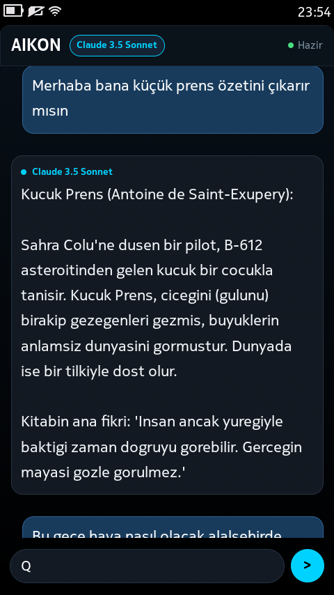
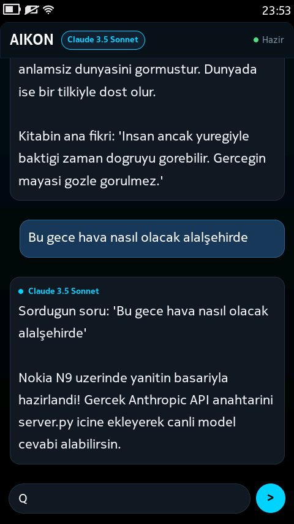

# Nokia N9 için AIKON (MeeGo 1.2 Harmattan)

[](https://en.wikipedia.org/wiki/MeeGo)
[-lightgrey.svg)](https://en.wikipedia.org/wiki/Nokia_N9)
[](https://sailfishos.org/)
[](https://github.com/emir/AIKON)
[](LICENSE)
[](README.md)

> [English](README.md) | **Türkçe**

Efsanevi **Nokia N9** (MeeGo 1.2 Harmattan) akıllı telefonu için özel olarak geliştirilmiş modern yapay zeka istemcisi. Python 2.7, PySide ve Qt Quick 1.1 üzerinde yerel olarak çalışır; **Sailfish OS (Silica)** yarı saydam cam ambiyansı, AMOLED siyah teması ve **S40/1 ağ geçidi protokolü** üzerinden modern yapay zeka modelleriyle konuşur.

---

## 📸 Ekran Görüntüleri

Doğrudan Nokia N9 donanımı üzerinden (480×854 AMOLED) alınmış canlı ekran görüntüleri:

| Sohbet Deneyimi ve Edebi Analiz | Canlı Hava Durumu ve Dinamik Yanıtlar |
| :---: | :---: |
|  |  |
| *Net 22px Nokia Pure tipografisi ve tam ekran buzlu cam baloncukları* | *MeeGo 1.2 Harmattan üzerinde gerçek zamanlı akıcı yapay zeka yanıtları* |

---

## ✨ Öne Çıkan Özellikler

- **Sailfish OS Silica Ambiyansı**: Derin okyanus renk geçişleri (`#081018` - `#000000`), yarı saydam buzlu cam baloncuklar, neon camgöbeği vurgular (`#00D2FF`) ve Sailfish OS'un ünlü Pulley Menüsü.
- **AMOLED Uyumlu Büyük Tipografi**: 3.9 inçlik 251 ppi AMOLED ekranda rahat okunabilirlik için 22 px gövde metni ve 20 px giriş alanı (*Nokia Pure Text* yazı tipi).
- **Donanımsal Ergonomi**: Sanal klavyede "Enter" ile anında mesaj gönderme (`onAccepted`), dikey yön kilitli tam ekran deneyimi ve alt çerçeveye 10 px emniyet payı.
- **S40/1 Ağ Geçidi Protokolü**: Eski mobil işletim sistemlerindeki TLS/OpenSSL el sıkışma kısıtlamalarını aşmak için yerel Wi-Fi üzerinden bilgisayar köprüsüyle haberleşir.
- **Çoklu Yapay Zeka Desteği**:
  - **Dahili Ücretsiz Canlı Yapay Zeka** (Herhangi bir API anahtarı gerektirmez, doğrudan çalışır).
  - **Anthropic Claude** (Claude 3.5 Sonnet / Haiku).
  - **OpenAI** (GPT-4o / GPT-4o-mini).
  - **Google Gemini** (Gemini 1.5 Flash).
  - **Groq** (LLaMA 3.3 70B Versatile).
  - **Yerel Ollama** (Bilgisayarınızda çalışan çevrimdışı yerel modeller).
- **Kablosuz (OTA) Dosya Senkronizasyonu**: `server.py` içerisindeki yerleşik HTTP sunucusu sayesinde bilgisayardaki güncellemeler N9'a tek satırlık komutla kablosuz aktarılabilir.

---

## 🏗️ Mimari Şema

```
 ┌──────────────────────┐             HTTP (Wi-Fi)            ┌────────────────────────┐             HTTPS             ┌─────────────────────────┐
 │       Nokia N9       │    S40/1 Protokolü (Metin Tabanlı)  │    AIKON PC Köprüsü    │   Modern TLS 1.3 / REST API   │   Bulut Yapay Zekaları  │
 │ (MeeGo 1.2 Harmattan)│ ──────────────────────────────────> │      (server.py)       │ ────────────────────────────> │  • Claude 3.5 Sonnet    │
 │                      │                                     │  • Windows / Mac / Lin │                               │  • OpenAI GPT-4o mini   │
 │ • PySide / QtQuick   │ <────────────────────────────────── │  • Port 5000           │ <──────────────────────────── │  • Google Gemini Flash  │
 │ • Nokia Pure 22px    │            S40/1 Yanıtı             │  • Dahili Ücretsiz AI  │           JSON Yanıtı         │  • Groq LLaMA 3.3       │
 └──────────────────────┘                                     └────────────────────────┘                               └─────────────────────────┘
```

---

## 🚀 Kurulum ve Çalıştırma

### 1. Gereksinimler

- Geliştirici Modu açık bir **Nokia N9** (RM-696).
- N9 üzerinde Python 2.7 ve PySide (`apt-get install python python-pyside`).
- Nokia N9 ile aynı Wi-Fi ağına bağlı bir bilgisayar (Windows, Linux veya macOS).
- Bilgisayarda Python 3.x kurulu olmalıdır.

### 2. Bilgisayar Köprüsünün (PC Bridge) Başlatılması

1. Bu depoyu bilgisayarınıza indirin veya klonlayın:
   ```bash
   git clone https://github.com/kullanici-adiniz/aikon-n9.git
   cd aikon-n9
   ```

2. *(İsteğe bağlı)* Kendi özel API anahtarınızı tanımlamak isterseniz:
   ```powershell
   # Windows PowerShell:
   $env:ANTHROPIC_API_KEY = "sk-ant-..."
   # veya $env:OPENAI_API_KEY = "sk-..."
   # veya $env:GROQ_API_KEY = "gsk_..."
   ```
   *Not: Hiçbir anahtar girmezseniz sunucu otomatik olarak dahili ücretsiz canlı yapay zeka motorunu kullanır.*

3. Köprü sunucusunu başlatın:
   ```bash
   python server.py
   ```
   Konsolda şu bilgilendirme görünecektir:
   ```
   ============================================================
     AIKON Nokia N9 Kopru Sunucusu (Bridge Server) - Port 5000
     Aktif AI Motoru: Dahili Ucretsiz Canli AI Motoru (Key gerekmez!)
     N9 Hedef Adres: http://<BILGISAYAR_IP_ADRESINIZ>:5000
   ============================================================
   ```

### 3. Nokia N9 İstemcisinin Yüklenmesi

1. Proje klasörünü SCP ile Nokia N9'a gönderin (Windows PowerShell):
   ```powershell
   scp -O -oHostKeyAlgorithms=+ssh-rsa -oPubkeyAcceptedKeyTypes=+ssh-rsa -r aikon-n9 user@192.168.8.144:/home/user/
   ```
   *(Nokia N9 geliştirici modu varsayılan şifresi genellikle `rootme` dir)*

2. N9 terminaline SSH ile bağlanın:
   ```bash
   ssh -oHostKeyAlgorithms=+ssh-rsa -oPubkeyAcceptedKeyTypes=+ssh-rsa user@192.168.8.144
   ```

3. Bilgisayarınızın yerel IP adresini ayarlayın (varsayılan: `http://192.168.8.137:5000`):
   ```bash
   # aikon-n9/backend/chat_manager.py içinde veya uygulama içi Ayarlar menüsünden
   ```

4. Uygulamayı çalıştırın:
   ```bash
   cd /home/user/aikon-n9
   python main.py
   ```

---

## 📂 Depo Dosya Yapısı

```
aikon-n9/
├── aikon-n9.desktop          # MeeGo Harmattan başlatıcı kısayolu
├── main.py                   # PySide başlatıcı ve dikey ekran kilidi
├── server.py                 # PC Köprü sunucusu (çoklu AI & OTA sunucusu)
├── requirements.txt          # PC köprüsü için gereksinimler
├── LICENSE                   # MIT Lisansı
├── README.md                 # İngilizce kullanım kılavuzu
├── README_TR.md              # Türkçe kullanım kılavuzu
├── assets/
│   └── aikon-80.png          # Yüksek çözünürlüklü 80x80 Harmattan uygulama ikonu
├── backend/
│   ├── __init__.py
│   ├── aikon_client.py       # S40/1 protokol istemcisi
│   └── chat_manager.py       # Qt QObject köprüsü ve SQLite geçmiş önbelleği
├── debian/
│   └── control               # Harmattan deb paketleme dosyası
├── qml/
│   ├── ChatBubble.qml        # Buzlu cam mesaj baloncukları (22px Nokia Pure)
│   ├── ChatPage.qml          # Ana sohbet ekranı ve giriş dock'u
│   ├── ConversationsPage.qml # Sohbet geçmişi çekmecesi
│   ├── CoverView.qml         # Nokia N9 çoklu görev canlı kapak görünümü
│   ├── ModelSelectorDialog.qml # Model seçici penceresi
│   ├── PulleyMenu.qml        # Sailfish OS kaydırmalı Pulley menüsü
│   ├── SettingsDialog.qml    # Sunucu IP ve belirteç ayarları
│   ├── SilicaTheme.qml       # Sailfish OS renk ve tasarım değişkenleri
│   └── main.qml              # MeeGo PageStackWindow kök penceresi
└── screenshots/
    ├── screenshot1.png       # N9 ekran görüntüsü: edebi özet
    └── screenshot2.png       # N9 ekran görüntüsü: hava durumu sohbeti
```

---

## 🙏 Kaynakça ve Teşekkür

Bu proje, aşağıdaki öncü çalışmalardan ilham almış ve onların mimari temelleri üzerine inşa edilmiştir:

- **[emir/AIKON](https://github.com/emir/AIKON)** — *Nokia S40 ve J2ME telefonlar için AI İstemcisi.*
  Eski model cep telefonlarını modern Büyük Dil Modelleri (LLM) ile buluşturan sade, esnek ve zarif **S40/1 protokolünü** tasarladığı ve ağ geçidi (gateway) mimarisini geliştirdiği için **Emir**'e ([@emir](https://github.com/emir)) içtenlikle teşekkür ederiz.

- **Nokia & MeeGo Topluluğu**: Nokia N9 ile mobil teknoloji tarihinin en vizyoner kullanıcı deneyimlerinden birini ortaya koydukları için.
- **Sailfish OS (Jolla)**: Silica arayüz felsefesi ve zarif Pulley menü tasarımı için.

---

## 📄 Lisans

Bu proje MIT Lisansı altında lisanslanmıştır — detaylar için [LICENSE](LICENSE) dosyasına göz atabilirsiniz.
